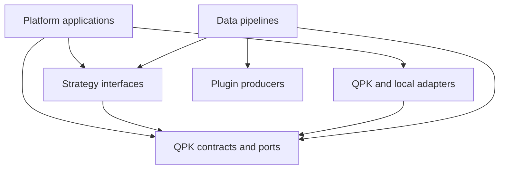
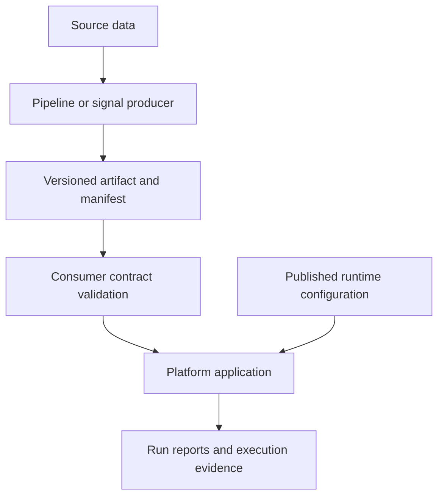

# QuantStrategyLab architecture

This page maps repository responsibilities and the dependency boundaries used
when changing them. Source ownership, artifact consumption, optional services,
and deployed capability are separate concerns. A repository's presence in this
map does not establish its production status.

The [incremental architecture proposal](adr/0001-incremental-architecture-boundaries.md)
describes how to improve these boundaries while preserving existing behavior.
The [architecture conventions](architecture-conventions.md) give implementation
and verification guidance. Repository contracts remain authoritative for their
interfaces and data formats.

## Repository responsibilities

The following map covers 26 repositories. Groups describe responsibility, not a
requirement to combine repositories or release them together.

| Responsibility | Repositories | Owned behavior |
| --- | --- | --- |
| Shared contracts and reusable infrastructure | `QuantPlatformKit` | Domain contracts, ports, common runtime helpers, reusable broker and cloud adapters. |
| Strategy domains | `UsEquityStrategies`, `HkEquityStrategies`, `CnEquityStrategies`, `CryptoStrategies` | Strategy formulas, catalogs, manifests, input requirements and compatibility metadata. |
| Plugin producers | `QuantStrategyPlugins` | Plugin definitions, execution specifications, observations and research output. |
| Data and artifact production | `UsEquitySnapshotPipelines`, `HkEquitySnapshotPipelines`, `CnEquitySnapshotPipelines`, `CryptoLivePoolPipelines`, `MarketSignalSources`, `ResearchSignalContextPipelines` | Source acquisition, transformations, snapshots, signal artifacts, provenance and consumer-facing validation. |
| Platform applications | `BinancePlatform`, `CharlesSchwabPlatform`, `InteractiveBrokersPlatform`, `LongBridgePlatform`, `AlpacaPlatform`, `FirstradePlatform`, `QmtPlatform` | Platform capabilities, application composition, broker integration and platform-owned runtime state within each repository's supported mode. |
| Configuration and compatibility | `QuantRuntimeSettings` | Runtime configuration, compatibility bundles, repository policy and management services. |
| AI task service | `QuantAIService` | Task and advisory result contracts, model-service integration and related clients. |
| Connection operations | `IBKRGatewayManager`, `SchwabTokenAutoRefresher` | Gateway lifecycle and credential-renewal operations. |
| Advisory research | `QuantAdvisorResearch`, `PoliticalEventTrackingResearch` | Research reports and event context under the advisory boundary. |
| Organization conventions | `.github` | Shared documentation, contribution templates and organization metadata. |

Supported modes and broker capabilities belong to the relevant platform
repository. A shadow implementation or an offline adapter does not establish
live execution support. Connection utilities do not own strategy selection or
order decisions. Advisory output follows the
[advisory and research boundary](advisory-research-boundary.md).

## Three kinds of relationship

### Package dependencies

A dependency declaration states which package a consumer installs. An import
states which module it executes. Both matter when assessing coupling: installed
distribution metadata alone cannot prove that a test imported that distribution.

The diagram shows the intended direction of source dependencies. Arrows point
from a consumer to its dependency. QPK boxes are logical module boundaries
inside `QuantPlatformKit`, not a proposal for additional distribution packages.

Each consumer declares the subset it needs. For example, platform manifests
select their strategy domains, and the US equity pipeline consumes strategy and
plugin packages. Optional dependencies are listed separately below. The exact
installed revisions come from consumer manifests and locks; they are not copied
into this overview.

The shared contract boundary is narrower than the entire QPK package. Contracts
and ports describe values and interactions without owning a broker session.
QPK also contains broker-specific and cloud-specific implementations. Those
implementations belong at the edge and must not become prerequisites for
importing an unrelated contract or evaluating a formula.

Strategy formulas should depend on explicit input values and contracts.
Compatibility metadata may name supported platforms, input capabilities and
adapter modes. These declarations do not justify constructing broker clients or
embedding broker request handling in a formula. Existing entrypoints with
monitoring or persistence effects require characterization before those effects
move to application composition.

### Artifact and configuration flow

Artifact delivery is a data relationship, even when the producer and consumer
have no package dependency. Arrows in this diagram indicate data flow.

The consumer retains schema checks, provenance, freshness, hashes and its
existing admissibility rules. A storage path or a filename is not an interface
version. Changes to serialization, missing-value treatment, ordering or digest
inputs affect this boundary even when Python signatures remain unchanged.

Configuration describes intended operation. Broker observations, unresolved
execution state and recorded fills have separate sources of truth. A settings
value, successful import or completed compatibility check does not replace those
observations.

### Optional AI and research integration

Optional integrations are declared capabilities, not part of every evaluation
path. Preserve the distinction in package metadata, imports and tests.

| Consumer | Optional dependency | Purpose |
| --- | --- | --- |
| `UsEquityStrategies` research extra | `QuantStrategyPlugins` | Research composition and comparisons. |
| `QuantStrategyPlugins` AI extras | Clients provided by `QuantAIService` | Advisory and native audit integration. |
| `UsEquitySnapshotPipelines` AI extra | Client provided by `QuantAIService` | Optional AI-assisted processing. |

Optional integration results retain their existing output contracts and
authority limits. Shared value types and ordinary import paths should not
initialize model clients. Research reports are consumed under the
[advisory boundary](advisory-research-boundary.md); they are not broker commands.

## Application composition and extension points

Platform applications assemble settings, clocks, data access, strategy
interfaces, execution adapters, notification publishers and state stores.
Dependencies should be visible at this composition boundary. Moving a global
dependency into an argument must preserve its lifecycle and side-effect order.

Use the existing
[QPK ports and repository boundaries](https://github.com/QuantStrategyLab/QuantPlatformKit/blob/main/docs/platform-repo-boundaries.md)
and
[shared strategy loader](https://github.com/QuantStrategyLab/QuantPlatformKit/blob/main/docs/adr/0004-strategy-loader-unification.md).
The platform-neutral requirement applies to shared contracts and strategy
formulas; reusable broker adapters remain explicitly broker-specific.

| Extension | Primary change location | Compatibility evidence |
| --- | --- | --- |
| Broker or exchange | Platform composition, an adapter and its capability declaration | Existing port behavior, supported modes, request mapping and failure results. |
| Strategy | Domain implementation, catalog, manifest and existing runtime adapter registration | Declared inputs, decision schema, supported capabilities and unchanged consumers. |
| Data source | Producer adapter, transformation and artifact contract | Input identity, timestamps, schema, provenance and consumer validation. |
| Plugin | Existing plugin specification, catalog and producer | Envelope, registration, disabled behavior and the declared consumer boundary. |
| Storage or notification implementation | Existing port implementation and composition registration | Call ordering, error classification and serialization compatibility. |

The objective is to localize each extension. A shared helper is appropriate when
multiple consumers have the same semantics, including error behavior and
atomicity. Similar names or matching source lines alone do not establish that
equivalence. Ordinary functions and explicit registries are sufficient when
they express the required variation.

## Version and compatibility governance

Use the existing
[QRS compatibility model](https://github.com/QuantStrategyLab/QuantRuntimeSettings/blob/main/docs/qsl-org-architecture.md).
Its sources have different responsibilities:

| Source | Responsibility |
| --- | --- |
| [Compatibility bundles](https://github.com/QuantStrategyLab/QuantRuntimeSettings/tree/main/compat/bundles) | Intended internal dependency sets. |
| [Repository tier policy](https://github.com/QuantStrategyLab/QuantRuntimeSettings/blob/main/compat/repo-tiers.toml) | Tier and upgrade-ring policy. |
| Consumer `qsl.toml` | Selected bundle and repository policy metadata. |
| Consumer package manifests and lock files | Declared and resolved dependencies. |
| [Internal dependency matrix](https://github.com/QuantStrategyLab/QuantRuntimeSettings/blob/main/internal_dependency_matrix.json) | Derived snapshot of consumer dependencies. |

The existing
[qslctl implementation](https://github.com/QuantStrategyLab/QuantRuntimeSettings/blob/main/python/scripts/qslctl.py)
provides `check`, `check-all`, `report`, `plan` and `generate-matrix` operations.
The
[matrix checker](https://github.com/QuantStrategyLab/QuantRuntimeSettings/blob/main/python/scripts/check_internal_dependency_matrix.py)
checks the derived snapshot against a prepared workspace. Follow their documented
scope instead of introducing a second policy file or parallel checker.

Different consumers may intentionally use different revisions. Evaluate each
against its selected bundle and actual imported source. Report matrix freshness,
bundle conformance and installed-source identity separately. An incomplete
workspace yields incomplete coverage. A shared-library refactor and production
adoption of its new version are separate changes.

## Documentation ownership

This overview owns the repository map and cross-cutting boundary explanations.
The [QPK specification index](https://github.com/QuantStrategyLab/QuantPlatformKit/blob/main/docs/README.md)
owns navigation to shared runtime contracts. QRS owns compatibility policy and
its tooling. Platform documentation owns adapter behavior and supported modes;
producer documentation owns artifact generation and consumer contracts.

Link to the owning specification instead of copying field lists or operating
steps. Read it at the revision consumed by the application. When a document is
replaced, update incoming links and identify its replacement while retaining
required design and research evidence.

## Design references

- [LEAN system overview](https://www.quantconnect.com/docs/v2/lean-engine/getting-started)
  separates data feeds, transactions, results and time-driven processing.
- [NautilusTrader architecture](https://nautilustrader.io/docs/latest/concepts/architecture/)
  distinguishes domain components, engines and adapters.
- [NautilusTrader adapter guidance](https://nautilustrader.io/docs/latest/developer_guide/adapters/)
  ties shared extraction to common semantics and testable protocol ownership.
- [Freqtrade configuration](https://www.freqtrade.io/en/stable/configuration/)
  documents source precedence and the effective configuration.
- [Freqtrade strategy interfaces](https://www.freqtrade.io/en/stable/strategy-customization/)
  distinguish interface versions explicitly.

These references inform responsibility and compatibility decisions. Their
engines, languages and runtime models are not prerequisites for this design.
